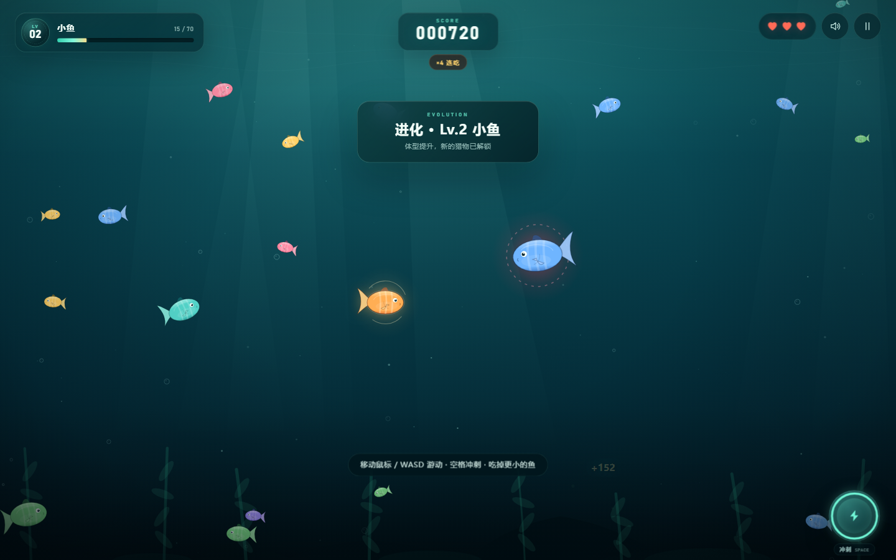

# 深海吞噬 · 大鱼吃小鱼

一款用原生 HTML / CSS / Canvas 制作的海底生存进化小游戏。没有外部依赖，不需要构建，双击 `index.html` 就能玩。



## 立即开始

直接用 Chrome、Edge 或 Safari 打开 `index.html`。

如果浏览器对本地文件限制较严，也可以在项目目录里启动一个静态服务器，例如：

```powershell
python -m http.server 8000
```

然后打开 `http://localhost:8000`。

## 操作

| 操作 | 桌面端 | 手机 / 平板 |
| --- | --- | --- |
| 游动 | 移动鼠标，或 `WASD` / 方向键 | 在屏幕任意处按住拖拽，生成虚拟摇杆 |
| 冲刺 | `Space` | 右下角冲刺按钮 |
| 暂停 | `Esc` / `P` | 右上角暂停按钮 |
| 静音 | `M` | 右上角音效按钮 |

## 玩法

- 吃掉**体型比你小**的鱼，成长条填满后进化，体型会变大。
- **红色光晕**的鱼比你大，碰到会损失一颗生命；冲刺期间有短暂无敌。
- 连续进食会累积连击倍率，最高 `×5`，用来冲高分。
- 一共 5 个成长阶段：幼鱼 → 小鱼 → 中鱼 → 大鱼 → 霸主。填满最后一条成长条即可称霸深海。
- 共 3 颗生命，部分进化阶段会恢复生命。最高分会保存在浏览器本地。

## 文件说明

```text
index.html      页面结构与所有界面
styles.css      深海视觉、HUD、响应式布局
game.js         游戏循环、鱼群 AI、吞噬成长、音效与输入
preview.png     游戏预览图
```

游戏中的体型、速度、关卡成长值集中在 `game.js` 的 `LEVEL_QUOTAS`、`spawnFish()` 等位置，方便按需要调节难度。
